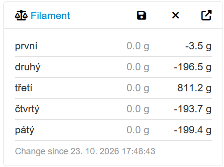
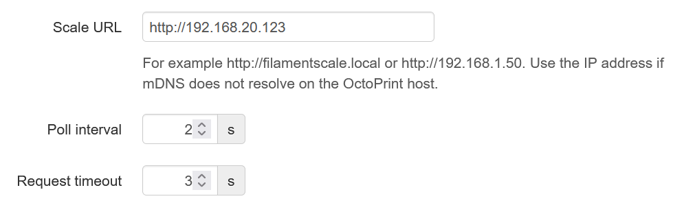

# OctoPrint-FilamentScale

OctoPrint plugin that shows the spool weights from a [FilamentScale](https://forgejo.bliksoft.cz/jjelinek/elektro-ESP32-FilamentScale) WiFi scale in a sidebar panel.



OctoPrint polls the scale's `/api/weights` endpoint in the background (every 2 s by default) and pushes the readings to every open browser tab. Only calibrated sensors are shown.

Buttons in the panel header:

- **Save** remembers the current weights. Each sensor then also shows its change since the save, for example to watch consumption during a print. The snapshot is stored on the OctoPrint server, so all browsers see the same one and it survives restarts.
- **Clear** (shown while a snapshot exists) removes the snapshot.
- **Open** opens the scale's own web interface for calibration, naming spools and setting their current weight. The link uses the configured scale URL, so it only works from browsers that can reach the scale.

## Installation

Install into OctoPrint's Python environment:

```
pip install .
```

or, in OctoPrint, open Plugin Manager → Get More → "...from URL" and enter the URL of a zip archive of this repository.

## Configuration

Settings → FilamentScale:



- **Scale URL** – defaults to `http://filamentscale.local`. Use the IP address if mDNS does not resolve on the OctoPrint host.
- **Poll interval** – seconds between requests to the scale.
- **Request timeout** – seconds to wait for the scale before marking it offline.

## Development

```
python -m venv venv
venv\Scripts\activate          # Windows; use "source venv/bin/activate" elsewhere
pip install octoprint
pip install -e .
octoprint serve
```

Then open http://localhost:5000. Changes to Python files need an OctoPrint restart; changes to templates, JS and CSS need a restart and a browser reload, unless OctoPrint runs with `--debug`.

## License

[GNU Affero General Public License v3.0 or later](LICENSE)
